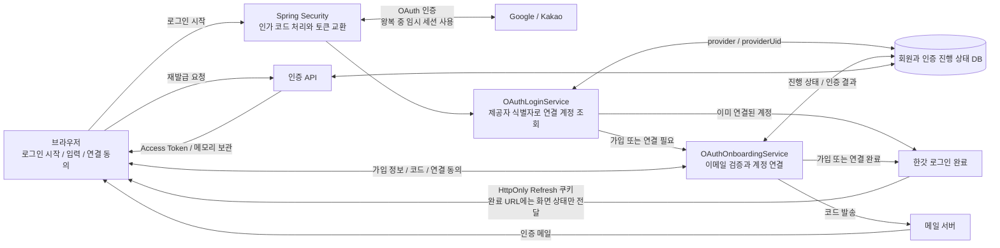
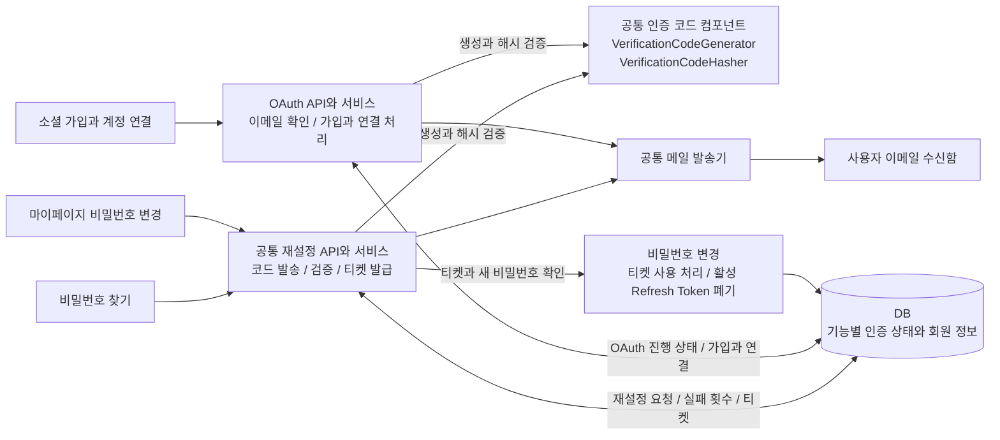
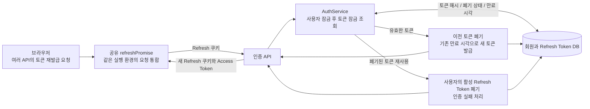

# 한갓지도 포트폴리오 초안

수정 기준: 2026-09-28 개정 회고, 2026-09-29 사용자 보완 내용과 현재 회원 인증 코드.

한적한 제주 여행지를 탐색하고 여행 코스를 계획하는 서비스입니다. 회원 인증을 담당하며 일반 회원가입, Google과 Kakao 소셜 로그인, 이메일 인증, 비밀번호 재설정, 로그인 토큰 관리를 구현했습니다.

## 페이지 구성

프로젝트 소개 → 담당 영역 요약 → 기술 스택 → 시스템 아키텍처 → 담당 영역 상세 → 트러블슈팅과 설계 결정 순서로 구성합니다. 담당 영역 상세는 기존 프로젝트처럼 기본적으로 접어 두고, 아래 세 가지 사례는 펼쳐서 표시합니다.

### 담당 영역 상세에 넣을 내용

- 일반 회원가입과 이메일 인증을 통한 계정 활성화
- Google과 Kakao 로그인, 이메일 인증을 통한 기존 계정 연결
- 이메일 코드와 일회용 티켓을 이용한 비밀번호 재설정, 마이페이지의 동일 API 재사용
- 비밀번호 재설정과 소셜 가입 및 계정 연결의 공통 인증 코드 생성과 해시 검증
- Refresh Token 회전, 재사용 감지, 폐기와 만료 정책

### 인증 코드의 재사용 범위

| 사용 흐름 | 코드 확인 후 가능한 작업 | 실제 재사용 범위 |
|---|---|---|
| 비밀번호 찾기 | 일회용 티켓으로 새 비밀번호 설정 | 비밀번호 재설정 API |
| 마이페이지 비밀번호 변경 | 이메일 확인 후 비밀번호 변경 | 비밀번호 찾기와 동일한 발송, 검증, 재설정 API |
| Google과 Kakao 신규 가입 | 이메일 확인 후 가입 처리 | 공통 코드 생성기와 해시 검증기 |
| Google 기존 계정 연결 | 연결 동의 후 이메일 코드를 확인하고 연결 완료 | 공통 코드 생성기와 해시 검증기, 연결용 인증 목적 |
| Kakao 기존 계정 연결 | 가입 진행 중 이메일 확인 후 기존 계정을 조회하고 연결 동의 | 이미 완료한 코드 인증 결과를 재사용하며 추가 코드 발송 없음 |

`VerificationCodeGenerator`와 `VerificationCodeHasher`를 비밀번호 재설정 서비스와 소셜 가입 및 연결 서비스에서 함께 사용했습니다. 인증 목적과 요청 식별자를 해시 입력에 포함하고, 검증 이후의 가입, 연결, 비밀번호 변경 처리는 각 서비스에서 관리하도록 분리했습니다. 코드 생성과 입력 정규화, 해시 검증은 공통으로 관리하면서 기능별 권한과 진행 상태는 구분했습니다.

**실제 코드: 인증 목적과 요청을 포함한 해시 입력**

```java
String message = purpose.name()
        + '\0'
        + challengeId
        + '\0'
        + normalizedCode;
```

인증 목적은 `PASSWORD_RESET`, `OAUTH_SIGNUP`, `OAUTH_LINK`로 구분합니다. 일반 회원가입의 이메일 확인은 별도의 링크 토큰 방식입니다.

첫 번째는 OAuth와 계정 연결 설계, 두 번째는 비밀번호 재설정 방식의 변경과 시도 제한 보완, 세 번째는 토큰 재발급의 동시성과 수명 관리 사례입니다. 각 사례는 전체 아키텍처, 문제 원인, 해결 과정, 결과 순서로 통일합니다.

| 사례 | 중심 질문 | 강조할 기여 |
|---|---|---|
| OAuth와 계정 연결 | 어떤 소셜 계정을 기존 계정에 연결할 수 있는가? | 백엔드의 인증 책임, 이메일 소유권 확인, 연결 동의 |
| 비밀번호 재설정 | 누구에게 새 비밀번호를 설정할 권한을 주는가? | 임시 비밀번호 요구사항 변경, 코드와 티켓의 역할 분리, 기존 API 재사용 |
| 토큰 재발급 | 발급된 로그인 권한을 언제까지 유지하고 언제 폐기하는가? | 잠금과 회전, 재사용 감지, 최초 만료 시각 유지 |

---

## 1. 소셜 로그인에서 제공자 인증만으로는 기존 한갓 계정 연결을 허용할 수 없었습니다.

### 전체 아키텍처



그림은 OAuth의 서버 처리와 계정 연결 경로를 함께 보여줍니다. 카카오의 기존 계정 조회는 이메일 코드 검증 이후에 진행하며, 이미 연결된 소셜 계정의 일반 로그인과 구분합니다.

### 문제 원인

1. Google과 Kakao 로그인을 일반 회원 계정과 연결하는 흐름을 설계하면서, 당시 카카오 연동 환경에서는 이메일을 제공받지 못해 별도 입력과 인증이 필요했습니다.
2. 입력한 이메일만으로 기존 한갓 계정의 소유권을 판단할 수 없고, 인증 전에 계정 정보를 안내하면 다른 사람의 가입 여부가 드러날 수 있었습니다.
3. 제공자 인증과 한갓 계정 연결의 판단을 서버에서 맡고, 이메일 소유권이 확인된 이후에 연결을 허용하도록 책임과 처리 순서를 정해야 했습니다.

### 해결 과정

- Spring Security가 인가 코드 처리와 제공자 토큰 교환을 담당하도록 하고, Client Secret과 계정 연결 판단을 백엔드에서 관리했습니다.
- 카카오는 이메일 입력 → 코드 검증 → 기존 계정 조회 → 연결 동의 순서로 처리하고, 서버의 인증 진행 상태를 재사용해 동의 단계에서 코드를 다시 요구하지 않았습니다.
- OAuth 왕복에는 임시 세션을 사용하고 콜백 후 폐기했으며, 일반 API는 JWT 인증으로 분리했습니다.
- 계정 연결을 서버의 검증 결과로 결정하기 위해 이 구조를 선택했고, 완료 URL에는 화면 상태만 전달하며 Refresh Token은 HttpOnly 쿠키, Access Token은 프론트 메모리로 분리했습니다.

**실제 코드: 로그인 완료 URL에 화면 상태만 전달**

```java
private String callbackUrl(String result) {
    return frontendUrl + "/oauth/callback?result=" + result;
}
```

Refresh Token은 이 리다이렉트 전에 쿠키로 설정하며, 화면의 `result` 값 자체를 인증 근거로 사용하지 않습니다.

### 결과

카카오 계정 연결은 이메일 소유권 확인과 연결 동의를 모두 거치도록 구성했습니다. 인증을 마친 사용자는 코드를 다시 받지 않고 연결을 완료할 수 있으며, 로그인 완료 URL에는 한갓 JWT나 제공자 토큰을 포함하지 않도록 했습니다. 제공자 인증 처리와 계정 연결 판단은 서버가 담당하고, 프론트는 입력과 연결 안내를 맡도록 책임을 나눴습니다.

---

## 2. 비밀번호 찾기에서 임시 비밀번호 전달과 인증 로직의 중복을 피해야 했습니다.

### 전체 아키텍처



비밀번호 찾기와 마이페이지는 같은 API를 사용하고, 소셜 가입과 계정 연결은 별도 API에서 공통 코드 생성기와 해시 검증기를 사용합니다. 메일에는 인증 코드를 전달하고, 새 비밀번호 설정은 검증 후 받은 일회용 티켓으로 허용합니다.

### 문제 원인

1. 기존 비밀번호 찾기 요구사항을 검토하면서, 임시 비밀번호를 메일로 받아 로그인한 뒤 다시 비밀번호를 변경해야 하는 흐름을 확인했습니다.
2. 비밀번호 찾기와 마이페이지의 변경 로직을 따로 구현하고 소셜 가입과 계정 연결에서도 코드 처리를 각각 만들면, 유사한 검증이 중복되고 관리할 분기가 늘어날 수 있었습니다.
3. 이메일 확인 후 사용자가 직접 새 비밀번호를 설정하도록 개선하면서, 여러 기능의 공통 인증 처리는 재사용하고 기능별로 허용되는 작업은 구분할 필요가 있었습니다.

### 해결 과정

- 메일로 로그인용 비밀번호를 전달하지 않도록, 같은 화면에서 6자리 코드 확인 후 일회용 티켓으로 새 비밀번호를 설정하는 흐름을 선택했습니다.
- 비밀번호 찾기와 마이페이지가 동일한 발송, 검증, 재설정 API를 사용하게 해 별도의 비밀번호 변경 흐름을 중복 구현하지 않도록 했습니다.
- 소셜 가입과 계정 연결에서도 공통 코드 생성기와 해시 검증기를 사용하고, 인증 목적과 요청 식별자를 해시에 포함하면서 검증 후 처리는 각 서비스에서 관리했습니다.
- 코드와 티켓의 만료, 발송 횟수와 입력 실패 횟수를 제한하고, 검토 중 확인한 실패 횟수 롤백 문제는 잠금 조회와 `InvalidResetCodeException`의 롤백 제외로 보완했습니다.

적용 정책: 코드 유효시간 10분, 입력 실패 최대 5회, 티켓 유효시간 5분, 코드 발송은 서버 프로세스별로 10분 동안 이메일별 3회와 IP별 10회 제한.

코드 발송 단계에서는 기존 비밀번호를 유지하고, 유효한 티켓으로 변경을 요청해야 비밀번호가 바뀌도록 했습니다. 마이페이지에서도 이메일 확인을 거치도록 했으며, 발송 대상이 아닌 이메일에도 같은 형식의 정상 응답을 제공했습니다.

**실제 코드: 검증한 사용자에게만 재설정 티켓 발급**

```java
String ticket = TokenHasher.generateToken();
reset.markVerified(TokenHasher.hash(ticket));

return new AuthDto.VerifyResetCodeResponse(
        ticket,
        maskEmail(reset.getUser().getEmail()),
        PasswordResetRequest.TICKET_TTL.toMillis()
);
```

검증 성공 시 코드를 검증 완료 상태로 바꾸고, DB에는 티켓 해시를 저장합니다. 사용자가 받은 티켓은 새 비밀번호 설정 요청에 사용합니다.

**실제 코드: 실패 응답을 반환해도 입력 실패 횟수 보존**

검증 메서드에 `@Transactional(noRollbackFor = InvalidResetCodeException.class)`를 적용하고, 코드가 다를 때는 다음 처리를 수행합니다.

```java
if(!matched) {
    reset.addFailedAttempt();
    throw new InvalidResetCodeException();
}
```

재발송은 이전 미사용 요청을 무효화하고, 이미 검증한 코드와 사용 완료된 티켓은 다시 사용할 수 없도록 상태를 검사합니다.

### 결과

기존 요구사항의 임시 비밀번호 발급을, 이메일 코드를 확인한 사용자가 같은 화면에서 직접 새 비밀번호를 정하는 흐름으로 바꿨습니다. 비밀번호 찾기와 마이페이지의 변경 처리는 하나의 API 흐름으로 관리하고, 소셜 가입 및 계정 연결과도 코드 생성과 해시 검증 로직을 공유하도록 구성했습니다. 실패 횟수는 누적해 5회 실패한 요청을 제한하고, 사용한 코드와 티켓은 재사용할 수 없게 했으며, 비밀번호 변경 후에는 기존 Refresh Token으로 재발급할 수 없도록 했습니다.

---

## 3. 로그인 재발급에서 중복 요청과 토큰 만료 연장을 제어해야 했습니다.

### 전체 아키텍처



### 문제 원인

1. 로그인 재발급 흐름을 검토하면서, 같은 Refresh Token으로 요청이 겹치는 상황과 재사용 감지 후 처리, 재발급 시 만료 계산을 함께 확인했습니다.
2. 잠금 없이 처리하면 하나의 토큰이 중복 회전할 수 있고, 재사용 감지 후 폐기가 예외로 취소되거나 새 발급 시점마다 만료일이 연장될 수 있었습니다.
3. 재발급 이후에도 토큰의 일회성 사용과 정해진 로그인 수명을 유지하도록, 상태 변경과 만료 정책을 함께 관리해야 했습니다.

### 해결 과정

- 프론트의 중복 요청 제어만으로 서버의 경쟁을 막을 수 없으므로, 사용자와 토큰을 순서대로 잠근 뒤 최신 상태를 확인하고 기존 토큰 폐기와 새 발급을 처리했습니다.
- 폐기된 토큰이 다시 들어오면 해당 사용자의 활성 Refresh Token을 폐기하고, 이 경로의 `BaseException`으로 폐기 처리가 롤백되지 않도록 설정했습니다.
- 재발급할 때 현재 시각으로 만료일을 다시 계산하는 대신 기존 `expiresAt`을 전달해, 최초 발급 기준의 절대 만료 시각을 유지했습니다.
- 프론트에서는 진행 중인 재발급 요청을 `refreshPromise`로 공유해, 같은 실행 환경에서 여러 API가 동시에 재발급을 요청하는 상황을 줄였습니다.

**실제 코드: 이전 토큰 폐기와 기존 만료 시각 유지**

```java
token.touch();
token.revoke(RefreshRevokeReason.ROTATED);
String rawRefresh = issueRefreshToken(user, token.getExpiresAt());
```

**실제 코드: 재사용을 감지하면 활성 토큰 폐기**

```java
if(token.isRevoked()) {
    revokeAll(token.getUser().getId(), RefreshRevokeReason.REUSE_DETECTED);
    throw new BaseException(BaseResponseStatus.JWT_INVALID);
}else if(!token.isUsable()) {
    throw new BaseException(BaseResponseStatus.JWT_EXPIRED);
}
```

위 처리가 포함된 재발급 메서드는 `@Transactional(noRollbackFor = BaseException.class)`를 사용합니다.

### 결과

같은 토큰을 사용하는 재발급 요청을 잠금으로 순서대로 처리하고, 회전한 이전 토큰은 다시 사용할 수 없도록 했습니다. 재발급 때마다 로그인 가능 기간이 늘어나지 않도록 기존 만료 시각을 유지했으며, 같은 프론트 실행 환경의 중복 요청은 하나의 응답을 공유하도록 했습니다. 서로 다른 탭의 요청까지 공유하지는 않으므로, 이미 회전된 토큰을 다시 보내면 재사용 정책에 따라 재로그인이 필요할 수 있습니다.

---

## 초안 검토 메모 — 공개 본문에서 제외

- 작성 기준: 2026-09-28에 개정한 회원 보안 회고와 로컬 HanGat_Map 소스. 첫 사례는 설계 선택이며, 확인되지 않은 계정 탈취 사고를 해결했다고 쓰지 않는다.
- 두 번째 사례의 중심을 실패 횟수 롤백에서 재설정 방식 선택으로 바꿨다. 임시 비밀번호는 기존 요구사항과 DTO 제안이며, 운영 중인 이전 구현을 교체한 것으로 표현하지 않는다.
- 직접 정한 코드 입력 방식과 API 재사용 방향, 검토 후 반영한 일회용 티켓과 시도 제한을 구분한다. 세부 보안 원리를 모두 독자적으로 고안했다고 쓰지 않는다.
- 2026-09-29 사용자 편집의 1번 원인 두 번째 문장을 반영하고, 2번 원인 첫 번째 문장에 사용성 개선과 로그인용 비밀번호를 메일로 전달하지 않으려는 선택 이유를 반영했다. 코드라는 형식 자체가 더 안전하다는 표현은 사용하지 않는다.
- 재사용은 두 층으로 확인했다. 비밀번호 찾기와 마이페이지는 같은 API를 사용하고, 비밀번호 재설정과 OAuth 가입 및 연결은 같은 생성기와 해시 검증기를 주입받는다. 모든 인증 기능이 하나의 API나 상태 모델을 사용한다고 쓰지 않는다.
- 2026-09-29 사용자 요청에 따라 2번의 선택 이유에 변경 로직과 코드 검증을 기능마다 따로 둘 때의 중복 및 분기 증가를 반영했다. 실제로 별도 구현이 난립하던 운영 장애를 제거했다고 쓰지 않고 설계에서 피하려 한 복잡성으로 표현했다.
- 생성기, 해시 검증기, 메일 발송기와 요청 제한기는 공통 컴포넌트이지만 만료, 횟수 제한, 진행 상태 전체가 하나의 정책 모듈로 통합된 것은 아니다. 처음부터 모든 재사용을 계획했다는 개발 이력이나 중복 코드 감소 수치는 확인하지 않았다.
- Kakao 기존 계정 연결은 OAUTH_SIGNUP 단계의 이메일 인증 결과를 이어서 사용하며 별도 OAUTH_LINK 코드를 다시 발급하지 않는다. 모든 계정 연결이 OAUTH_LINK를 사용한다고 쓰지 않는다.
- 두 번째 사례에서 Git으로 확인한 코드 변경은 서비스 분리와 롤백 제외 범위 축소다. 기본 롤백이 문제를 일으키는 원리와 실제 Git에 남은 이전 구현을 혼동하지 않는다.
- 세 번째 사례의 잠금, 폐기 보존, 만료 시각 유지는 최초 구현 이력에도 포함된다. 동시 재발급 장애를 운영에서 재현하고 수정했다는 서술은 추가하지 않는다.
- 결과 문장은 확인한 구현을 설명한다. 이번 초안 작성에서 애플리케이션 테스트를 실행하지 않았으며 테스트 통과 수치와 성능 개선 수치는 넣지 않았다.
- 보강할 검증: 카카오 이메일 인증 전후 연결 안내, 잘못된 코드 5회 요청 각각의 트랜잭션 종료 후 DB 누적과 이후 정답 거절, 재발송 후 이전 요청 거절, 코드와 티켓의 재사용 및 만료, 비밀번호 변경 후 Refresh Token 폐기, 같은 토큰의 동시 재발급 및 재발급 전후 만료 시각 비교.
- 테스트 결과를 추가할 때는 결과 바로 앞에 초기 상태, 요청 횟수 또는 동시 요청 수, 실제 사용 DB를 한 줄로 적는다. 별도 테스트 조건 섹션은 만들지 않는다.
- 첫 사례의 가입 여부 보호 범위는 카카오의 이메일 인증 전 흐름으로 한정한다. 일반 회원가입은 중복 이메일 오류를 반환하므로 전체 서비스에 일반화하지 않는다.
- 이전 초안에 추가된 카카오 사업자 등록 괄호는 개정 회고의 범위에 맞춰 당시 연동 환경에서 이메일을 받지 못했다는 표현으로 통합했다. 모든 카카오 앱에 적용되는 자격 요건을 단정하지 않는다.
- 두 번째 사례는 이메일 발송 대상이 아닌 계정에도 같은 형식으로 정상 응답하도록 구현했다. 요청 제한이나 메일 발송 실패까지 언제나 동일하게 응답하거나 응답 시간이 같다고 쓰지 않는다.
- 발송 횟수 제한은 현재 서버 프로세스의 메모리 기반이다. 여러 서버의 합산 제한이나 재시작 후 유지로 확대하지 않는다. 코드 검증 실패 5회 제한과 발송 횟수 제한은 다른 정책이다.
- requestId는 인증 요청 조회용 식별자다. 특정 브라우저나 세션에 강하게 묶는 인증 수단이라고 설명하지 않는다.
- 비밀번호 변경 후 활성 Refresh Token 폐기는 확인했지만 모든 기기의 기존 Access Token이 즉시 무효화된다고 확대하지 않는다.
- 프론트의 과거 모의 API에는 티켓 만료가 10분으로 남아 있으나 실제 화면은 userAuth를 통해 백엔드 API의 만료값을 사용한다. 초안의 티켓 5분은 실제 백엔드 기준이다.
- 세 번째 사례의 `BaseException` 롤백 제외는 두 번째보다 넓다. 전용 예외로 좁혔다고 표현하지 않는다.
- 각 Mermaid 그림은 기능 전체 아키텍처의 초안이다. 사이트 반영 시 기존 프로젝트와 같은 SVG 스타일로 정리하고, 결과 화면은 실제 인증 또는 DB 확인 장면을 확보한 경우에만 추가한다.
- 프로젝트 기간, 팀원 수, 대표 화면과 서비스 전체 아키텍처는 기존 임시 값 대신 확인된 자료로 채운다. 담당 내용에 Gemini, AI 코스 생성, 배치 구현을 포함하지 않는다.
- 이 문서는 초안이며 사이트 파일과 배포 내용은 변경하지 않았다.
